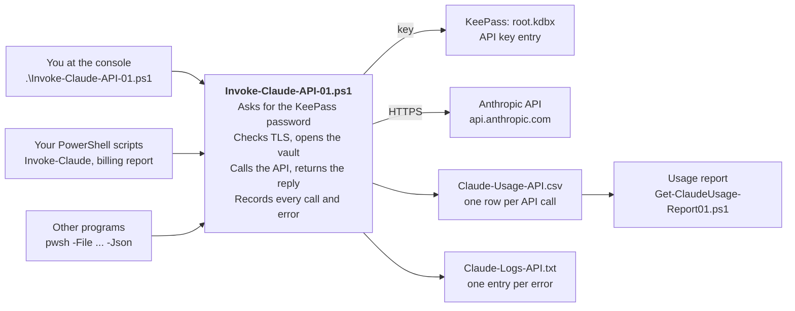

# Invoke-Claude Manual

Covers the toolkit as of October 2026.

- [Overview](#overview)
- [Setup](#setup)
- [Using Invoke-Claude](#using-invoke-claude)
- [Configuration](#configuration)
- [Billing report](#billing-report)
- [Usage tracking and reports](#usage-tracking-and-reports)
- [Error log and exit codes](#error-log-and-exit-codes)
- [Security](#security)
- [Troubleshooting](#troubleshooting)

## Overview

Invoke-Claude sends prompts to Anthropic's Claude API using an API key kept in KeePass, and records every call so you can see what it costs. One script does the work; two report scripts read its results. All three live in the same folder.

| File | What it does | Needs the KeePass password |
| --- | --- | --- |
| `Invoke-Claude-API-01.ps1` | Opens KeePass, calls the API, returns the reply, writes the usage and error logs | Yes |
| `Get-ClaudeBilling-Report01.ps1` | Makes one tiny test call (under 100 tokens) and shows its tokens and estimated cost | Yes |
| `Get-ClaudeUsage-Report01.ps1` | Reads the usage log and reports spend by day, model, caller and label, against a monthly budget | No (no API call) |

The main script writes two files beside itself: `Claude-Usage-API.csv` (one row per API call) and `Claude-Logs-API.txt` (one entry per error). Costs everywhere are estimates from a price table in the main script; Anthropic's invoice is the final word.



Every caller goes through the main script, which alone touches KeePass and the API; the usage report only reads the CSV it writes.

## Setup

Put the three scripts and your KeePass database in one folder, then run the main script once from a PowerShell window.

**Requirements**

- Windows PowerShell 5.1 or PowerShell 7+.
- The PoshKeePass module. The script offers to install it for your user only (no admin rights) the first time.
- Internet access to the PowerShell Gallery (first run only) and to `api.anthropic.com`.
- A KeePass database with no key file (master password only).

**The KeePass entry**

The API key is read from one entry. Its Title and User name must match the settings exactly; the key goes in the Password field.

| KeePass field | Must be | Setting |
| --- | --- | --- |
| Title | `Anthropic API` | `KeePassTitle` |
| User name | `keepassUser` (or your own; match the setting) | `KeePassUser` |
| Password | your API key (starts `sk-ant-`) | (none) |

**First run**

1. Open PowerShell and go to the folder: `cd <your folder>`.
2. Run `.\Invoke-Claude-API-01.ps1`.
3. Answer Y if it offers to install PoshKeePass.
4. Type the KeePass master password when asked.
5. You should see a reply, its token counts and an estimated cost, ending with `Exit code: 0 (Success)`.

If Windows refuses to run the script, allow local scripts for your account once: `Set-ExecutionPolicy -Scope CurrentUser RemoteSigned`. Files downloaded from the internet may also need `Unblock-File .\*.ps1`.

## Using Invoke-Claude

The same file works three ways: run it yourself, call `Invoke-Claude` from another PowerShell script, or run it with `-Json` from any other program.

### 1. Run it as a script

For a person at the keyboard. Prints the reply in colour and ends with an exit code.

```powershell
.\Invoke-Claude-API-01.ps1                                   # sends the default test prompt
.\Invoke-Claude-API-01.ps1 -Prompt "Summarise this: ..."
.\Invoke-Claude-API-01.ps1 -Prompt "Hi" -Model claude-sonnet-5-5 -MaxTokens 500 -Label "test"
```

### 2. Use it as a function from PowerShell

Dot-source the file (a dot, a space, then the path), then call `Invoke-Claude`. It returns an object instead of printing, and failures are errors you can catch.

```powershell
. .\Invoke-Claude-API-01.ps1

$R = Invoke-Claude -Prompt "Write a haiku about backups" -Label "nightly summary"
$R.Text
$R.TotalTokens
$R.EstimatedCostUsd

# Several prompts, one password prompt
$Results = "First question", "Second question" | Invoke-Claude

# Handling a failure
try {
    $R = Invoke-Claude "Hello"
} catch {
    $_.Exception.Message           # what went wrong, in plain words
    $_.Exception.Data.Reason       # e.g. ApiKey, DatabaseAuth
    $_.Exception.Data.ExitCode     # the matching exit code
    $_.Exception.Data.LogFile      # where it was logged
}
```

Dot-sourcing loads only `Invoke-Claude` into your session; it doesn't touch your own variables such as `$Prompt` or `$Model`.

### 3. Call it from another program

Add `-Json`. Standard output then carries exactly one line of JSON; status messages and the password prompt go to standard error. Check the exit code too.

```
pwsh -NoProfile -File Invoke-Claude-API-01.ps1 -Prompt "Hello" -Json -MasterPasswordFromStdin
```

Python example:

```python
import json, subprocess
r = subprocess.run(
    ["pwsh", "-NoProfile", "-File", "Invoke-Claude-API-01.ps1",
     "-Prompt", "Hello", "-Json", "-MasterPasswordFromStdin"],
    input=password + "\n", capture_output=True, text=True)
result = json.loads(r.stdout)
if result["ok"]:
    print(result["text"], result["estimatedCostUsd"])
else:
    print(result["error"]["reason"], result["error"]["message"], r.returncode)
```

Use `powershell.exe` instead of `pwsh` for Windows PowerShell 5.1.

### Using the output

Besides the returned object and the JSON, the reply can be picked up three more ways.

- **A variable.** After every call, in script and function modes, the result is kept in `$ClaudeOutput` (set `OutputVariable` to change the name). Other scripts in the same PowerShell session read `$ClaudeOutput.Text`, `$ClaudeOutput.TotalTokens` and so on. Several prompts at once give an array.
- **A file.** Set `OutputFile` and the reply is saved there after every call, replacing the previous one, for other apps to read. `OutputFileFormat = 'Text'` saves just the reply; `'Json'` saves the whole result. Works in every mode.
- **Captured from script mode.** Set `ShowResponse = $false` and the script prints nothing about the reply; it returns the result instead:

```powershell
$R = .\Invoke-Claude-API-01.ps1 -Prompt "Hello"
$R.Text
```

Add `ShowStatus = $false` to hide the progress lines too, leaving only the password prompt, warnings and errors.

### Parameters

| Parameter | Script / -Json | Function | Default | Meaning |
| --- | --- | --- | --- | --- |
| `-Prompt` | Yes | Yes (or piped in) | `DefaultPrompt` setting | The message to send |
| `-Model` | Yes | Yes | `claude-haiku-5-5` | Model to use |
| `-MaxTokens` | Yes | Yes | 100 | Longest reply allowed, in tokens |
| `-Temperature` | Yes | Yes | API default | 0.0 to 1.0; lower is more predictable |
| `-System` | Yes | Yes | none | System prompt |
| `-Label` | Yes | Yes | none | Free text saved in the usage log, for grouping costs |
| `-MasterPassword` | No | Yes | asks | KeePass password as a SecureString |
| `-MasterPasswordFromStdin` | Yes | No | off | Read the password from the first line of standard input |
| `-MasterPasswordEnv NAME` | Yes | No | off | Read the password from environment variable NAME, then clear it |
| `-Json` | Yes | No | off | Output one JSON object instead of coloured text |

### The KeePass master password

It is asked for on every run or call and discarded as soon as the vault opens; the API key is never kept between calls. A caller that already has it can pass it instead with the password parameters above. `-MasterPasswordFromStdin` is the safest choice for other programs. There is deliberately no way to pass the password as a plain command-line argument, because other programs on the computer can read those.

### What comes back

The function returns one object per prompt. With `-Json`, the same fields come back in camelCase, plus `ok`.

| Field | Meaning |
| --- | --- |
| `Text` | The reply |
| `Model` | Model that answered |
| `StopReason` | Why the reply ended (`end_turn`, `max_tokens`, ...) |
| `Truncated` | True if the reply was cut off at `MaxTokens` |
| `InputTokens`, `OutputTokens` | Tokens sent and received |
| `CacheWriteTokens`, `CacheReadTokens` | Prompt-caching tokens (0 if unused) |
| `TotalTokens` | All of the above added together |
| `EstimatedCostUsd` | Estimated cost of the call (empty if the model has no price listed) |
| `InputRate`, `OutputRate`, `PriceTier` | Rates used, per million tokens, and `standard` or `long-prompt` |
| `Label` | The label you passed |
| `Id` | Anthropic's message ID |
| `ElapsedSeconds` | How long the call took |
| `Timestamp` | When it finished (UTC) |
| `Usage` | The raw usage block from the API |

On failure, `-Json` returns `ok: false` and an `error` object with `reason`, `exitCode`, `message`, `details`, `httpStatus`, `requestId` and `logFile`.

## Configuration

All settings live in one block near the top of `Invoke-Claude-API-01.ps1`, under `# ── SETTINGS`, as `Name = value` lines inside `$ClaudeConfig`. Edit the value, save, and the next run uses it. Parameters such as `-Model` override the request defaults for a single call.

### General

| Setting | Default | Meaning |
| --- | --- | --- |
| `WorkingDir` | the script's folder | Where the KeePass file and logs live. Pasted into a console, it falls back to the current folder. To pin it: `WorkingDir = 'C:\Path\To\Folder'` |
| `RequiredModules` | `@('PoshKeePass')` | Modules checked before opening KeePass |
| `AuthPauseSeconds` | 2 | Pause after "Authenticated." in script mode (0 = none) |

### Logs

| Setting | Default | Meaning |
| --- | --- | --- |
| `ErrorLogEnabled` | `$true` | Write errors to the error log |
| `ErrorLogFile` | `Claude-Logs-API.txt` | A name in `WorkingDir`, or a full path |
| `ErrorLogMaxKB` | 1024 | Past this size the log is renamed `.old` and a new one starts |
| `UsageLogEnabled` | `$true` | Write one row per API call to the usage log |
| `UsageLogFile` | `Claude-Usage-API.csv` | A name in `WorkingDir`, or a full path. If you change it, change `$UsageLogFile` in the usage report too |

### TLS (secure connection)

| Setting | Default | Meaning |
| --- | --- | --- |
| `TlsVersion` | `Tls12` | `Tls12`, `Tls13` (Windows 11 or Server 2022 and later) or `SystemDefault` (let Windows choose) |
| `VerifyTlsHandshake` | `$true` | Test a real TLS connection to the API once per session, before the key is used |

On each run the script checks that the chosen version is valid, supported by this PowerShell and Windows, and not switched off in Windows. Where a fix exists it offers it: install PowerShell 7, switch the protocol back on (admin rights and a restart), or use TLS 1.2 for that run.

### KeePass

| Setting | Default | Meaning |
| --- | --- | --- |
| `KeePassFileName` | `root.kdbx` | Database file, inside `WorkingDir` |
| `KeePassTitle` | `Anthropic API` | Title of the entry holding the key |
| `KeePassUser` | `keepassUser` | User name of the entry holding the key |
| `KeePassProfileName` | `KPProfile` | Temporary PoshKeePass profile; the process ID is added so parallel runs don't clash |

### API connection and request defaults

| Setting | Default | Meaning |
| --- | --- | --- |
| `AnthropicUri` | `https://api.anthropic.com/v1/messages` | API address |
| `AnthropicVersion` | `2023-06-01` | Sent as the `anthropic-version` header |
| `RequestTimeoutSec` | 60 | Give up if no reply within this many seconds |
| `Model` | `claude-haiku-5-5` | Model used when `-Model` isn't given |
| `MaxTokens` | 100 | Longest reply allowed, in tokens |
| `Temperature` | `$null` | 0.0 to 1.0; `$null` uses the API default |
| `System` | `''` | System prompt; empty = none |
| `DefaultPrompt` | a short test question | Sent when no prompt is given |

### Prices

`Prices` holds US dollars per million tokens for each model, as of October 2026. It is the only price table: the cost on each call, the usage log, the billing report and the usage reports all use it. When prices change, update it from [Anthropic's pricing page](https://platform.claude.com/docs/en/about-claude/pricing).

| Model | Input | Output | Cache write (5 min) | Cache read |
| --- | --- | --- | --- | --- |
| `claude-haiku-5-5` (prompt up to 100,000 tokens) | $0.10 | $0.50 | $0.125 | $0.01 |
| `claude-haiku-5-5` (longer prompt) | $0.50 | $2.50 | $0.625 | $0.05 |
| `claude-sonnet-5-5` | $2.00 | $10.00 | $2.50 | $0.10 |
| `claude-opus-5-5` | $4.00 | $20.00 | $5.00 | $0.20 |
| `claude-fable-5-1` | $10.00 | $50.00 | $12.50 | $0.25 |

To add a model, copy a line and change its name and rates. A model with no entry still works, but its cost shows as unknown and counts as zero in reports. The name matches by prefix, so `claude-haiku-5-5` also covers dated names such as `claude-haiku-5-5-20260601`.

### Output

| Setting | Default | Meaning |
| --- | --- | --- |
| `OutputVariable` | `ClaudeOutput` | Global variable that holds the latest result after each call (script and function modes); an array for several prompts. `''` = off |
| `OutputFile` | `''` (off) | File the reply is saved to after each call, replaced each time: a name in `WorkingDir` or a full path |
| `OutputFileFormat` | `Text` | `Text` = the reply only; `Json` = the whole result (reply, tokens, cost, model...) |

The file is UTF-8 without a byte-order mark, which most other apps expect.

### Script-mode display

These only affect what's printed when you run the script yourself (`$true` = show).

| Setting | Default | Shows |
| --- | --- | --- |
| `ShowResponse` | `$true` | The reply and its details. `$false` = nothing about the reply is printed; the result is returned instead, so `$R = .\Invoke-Claude-API-01.ps1` captures it |
| `ShowStatus` | `$true` | Progress lines: working folder, TLS, KeePass, "Calling API". Prompts, warnings and errors always show |
| `ShowModel` | `$true` | Model that answered |
| `ShowInputTokens` | `$true` | Tokens sent |
| `ShowOutputTokens` | `$true` | Tokens received |
| `ShowTotalTokens` | `$true` | Total tokens |
| `ShowStopReason` | `$true` | Why the reply ended |
| `ShowMessageId` | `$false` | Anthropic's message ID |
| `ShowElapsedTime` | `$true` | How long the call took |
| `ShowCost` | `$true` | Estimated cost |
| `ShowExitCode` | `$true` | Exit code and its meaning, at the end |

## Billing report

`Get-ClaudeBilling-Report01.ps1` makes one tiny call (about 20 tokens, a small fraction of a cent on Haiku) and shows exactly what it used and cost. Use it to check the key works and see current rates at a glance.

```powershell
.\Get-ClaudeBilling-Report01.ps1
```

It asks for the KeePass password, then shows the date, model, input, output and total tokens against a 100-token budget, the rates used, the input, output and total cost, and the cost per 1,000 such calls. The call is recorded in the usage log with the label `billing-report`. If the call fails, it shows the error and exits with the main script's exit codes.

| Setting | Default | Meaning |
| --- | --- | --- |
| `$LibraryFile` | `Invoke-Claude-API-01.ps1` | The main script's file name. Change it if you rename that file |
| `$ReportPrompt` | a one-sentence check | What it sends |
| `$ReportMaxTokens` | 40 | Longest reply allowed |
| `$TokenBudget` | 100 | Warns if a call uses this many tokens or more |
| `$ReportLabel` | `billing-report` | How its calls appear in the usage log |

It shows estimates only. Your credit balance and actual charges are in the Claude Console under Billing; the API used here doesn't report them.

## Usage tracking and reports

Every API call, successful or failed, adds one row to `Claude-Usage-API.csv`, and `Get-ClaudeUsage-Report01.ps1` turns that file into reports. The report makes no API call and needs no password.

### What is recorded

Prompt and reply text are never recorded. A failure before the API is reached (wrong password, missing entry) isn't a call, so it goes to the error log only. Failed calls are recorded with a cost of 0, since Anthropic doesn't bill them. The file opens directly in Excel.

| Column | Meaning |
| --- | --- |
| `Timestamp` | Local time with offset, e.g. `2026-10-13T09:42:10-03:00` |
| `Status` | `Success` or `Failed` |
| `Model` | Model used |
| `Label` | The `-Label` you passed, if any |
| `InputTokens`, `OutputTokens`, `CacheWriteTokens`, `CacheReadTokens`, `TotalTokens` | Token counts |
| `CostUsd` | Estimated cost, from the `Prices` table at the time of the call |
| `PriceTier` | `standard`, `long-prompt` or `unpriced` |
| `ElapsedSeconds` | How long the call took |
| `StopReason` | Why the reply ended |
| `Reason`, `HttpStatus` | For failures: the reason name and HTTP code |
| `MessageId`, `RequestId` | Anthropic's IDs, for support |
| `Caller` | The script or program that made the call |
| `Mode` | `Script`, `Function` or `Json` |
| `User`, `Computer` | Who ran it, and where |

To group costs by job, give each job its own label: `Invoke-Claude "..." -Label "nightly summary"`.

### Running reports

```powershell
.\Get-ClaudeUsage-Report01.ps1                                   # this month, every section
.\Get-ClaudeUsage-Report01.ps1 -Period Today
.\Get-ClaudeUsage-Report01.ps1 -Period LastMonth -Report Summary, Models
.\Get-ClaudeUsage-Report01.ps1 -From 2026-10-01 -To 2026-10-15
.\Get-ClaudeUsage-Report01.ps1 -Label 'nightly*'                 # only matching labels
.\Get-ClaudeUsage-Report01.ps1 -Model 'claude-opus*'
.\Get-ClaudeUsage-Report01.ps1 -ExportCsv .\october.csv           # also save the calls
```

| Parameter | Default | Meaning |
| --- | --- | --- |
| `-Period` | `ThisMonth` | `Today`, `Yesterday`, `ThisWeek`, `LastWeek`, `ThisMonth`, `LastMonth`, `Last7Days`, `Last30Days`, `ThisYear` or `All` |
| `-From`, `-To` | none | Exact dates, inclusive; override `-Period` |
| `-Report` | `All` | One or more sections, separated by commas |
| `-Label`, `-Model` | none | Filters; `*` wildcards allowed |
| `-MonthlyBudgetUsd` | the setting | Use a different budget for this run |
| `-ExportCsv` | none | Save the calls in the period to a CSV file |

### Report sections

| Section | Shows |
| --- | --- |
| `Summary` | Calls, failure rate, tokens, total cost, averages per call, busiest day |
| `Budget` | This calendar month's spend against your budget, the daily average, a projected month total, and on track, on pace to exceed, or over |
| `Daily` | Calls, failures, tokens and cost per day, with a running total |
| `Models` | Calls, tokens, cost and share of spend per model |
| `Callers` | The same per calling script or program |
| `Labels` | The same per label |
| `Top` | The most expensive and the slowest calls |
| `Failures` | Failed calls by reason, and the most recent ones with request IDs |

The Budget section always counts every call this month, whatever the period or filters.

### Report settings

At the top of `Get-ClaudeUsage-Report01.ps1`:

| Setting | Default | Meaning |
| --- | --- | --- |
| `$UsageLogFile` | `Claude-Usage-API.csv` | Must match `UsageLogFile` in the main script |
| `$MonthlyBudget` | 5.00 | US dollars per calendar month; 0 = no budget. Set this to your real budget |
| `$WeekStartsOn` | `Sunday` | `Sunday` or `Monday`, for the week periods |
| `$TopCount` | 5 | Rows in the Top and recent-failures lists |

The log only holds calls made through these scripts. Other tools using the same API key won't appear, so for exact totals compare with the Claude Console.

## Error log and exit codes

Every error, in every mode, is appended to `Claude-Logs-API.txt`, and each kind of failure ends the script with its own exit code.

### The error log

Each entry gives the time, reason, exit code, HTTP status and request ID when there is one, the message and details, then the context: mode, model, calling script, PowerShell version, user and computer.

```
2026-10-12 20:15:52 -03:00 | ERROR | ApiKey (exit 31) | HTTP 401 | Request req_011CTx...
  Message : API call failed (HTTP 401). The API key was rejected. ...
      Type       : authentication_error
      Request ID : req_011CTx...
  Context : mode Json | model claude-haiku-5-5 | caller C:\...\Invoke-Claude-API-01.ps1 | PowerShell 7.4.6 | user@PC
```

The screen, the JSON `logFile` field and `$_.Exception.Data.LogFile` all say where an error was logged. If the working folder can't be used, the log goes to the Windows temp folder. Passwords and keys are never written, and anything shaped like an API key is masked as `sk-ant-[MASKED]`.

### Exit codes

The script and `-Json` mode end with one of these numbers. Read it with `$LASTEXITCODE` in PowerShell, `%ERRORLEVEL%` in a batch file, the return code in other programs, or "Last Run Result" in Task Scheduler. As a function, the same name and number are in `$_.Exception.Data.Reason` and `.ExitCode`.

| Code | Reason | Meaning |
| --- | --- | --- |
| 0 | `Success` | It worked |
| 1 | `Unexpected` | An error not covered below; see the error log |
| 10 | `Settings` | A setting or parameter is invalid, or the working folder is missing |
| 11 | `Dependency` | PoshKeePass declined, failed to install or won't load |
| 12 | `Tls` | The chosen TLS version isn't available or failed its check |
| 20 | `DatabaseFile` | KeePass file not found, empty, invalid or access denied |
| 21 | `DatabaseAuth` | No master password given, or it wasn't accepted |
| 22 | `DatabaseEntry` | API key entry not found, or its key is empty |
| 30 | `ApiRequest` | API rejected the request (a setting or model name) |
| 31 | `ApiKey` | API key rejected |
| 32 | `ApiCredits` | Account out of credits |
| 33 | `ApiRetryLater` | Rate limited, overloaded or a server error; try again later |
| 34 | `ApiNoResponse` | No reply: timeout, DNS, TLS or connection problem |

## Security

The master password and API key are never shown on screen, written to disk or logs, or returned to the caller. What remains is brief exposure in memory on your own computer.

**What is protected**

- The password prompt is masked and never enters your PowerShell history.
- The master password is held only as a SecureString (encrypted in memory on Windows) and discarded as soon as the vault opens.
- The API key is never printed, logged, put in JSON or returned; it travels only to `api.anthropic.com` over TLS with the certificate checked.
- When the entry isn't found, only the other entries' user names are read, never their passwords.
- Anything shaped like an API key is masked in messages, JSON output and logs.
- The functions run in a private module, so their internals don't appear among your variables.
- On Windows PowerShell 5.1 the TLS setting is applied only during each request, then your previous setting is restored.

**What can still expose them**

- **Memory.** The key must exist as plain text briefly to go into the request, and .NET can't wipe it afterwards. Malware running as you, an administrator with a debugger, a crash dump or the page file could find it. This applies to any program that uses an API key.
- **A proxy that inspects HTTPS.** Some workplace networks and antivirus products decrypt traffic with their own trusted certificate and could see the key. The TLS check still passes in that case.
- **How a caller passes the password.** It is plain text inside the calling program, which must protect it. `-MasterPasswordEnv` clears the variable in the script, but the parent program's copy remains, and other programs running as you can read environment variables.
- **Linux and macOS.** A SecureString is only obscured there, not encrypted.

**Good practice**

- Never type `$env:KPW = 'mypassword'` or `ConvertTo-SecureString 'mypassword' -AsPlainText` in a console or save it in a script: the console line goes into your history, and the script keeps it in plain text.
- Prefer `-MasterPasswordFromStdin` when another program supplies the password.
- Give this API key its own workspace in the Claude Console with a spending limit, so a leaked key can't run up a large bill.
- Rotate the key if you ever suspect it has been seen.
- Never commit your `.kdbx` file or the logs; the repository's `.gitignore` excludes them.

## Troubleshooting

Most problems show a specific message and are recorded in `Claude-Logs-API.txt`. Find the message below.

| Message | Exit | What to do |
| --- | --- | --- |
| Can't ask for the KeePass master password: input is redirected | 21 | Run from a PowerShell window, or pass the password with `-MasterPasswordFromStdin`. If you're in a window where typing works, run `$Host.Name` and report what it prints |
| The working folder (WorkingDir) is empty / doesn't exist | 10 | Run the saved `.ps1` file rather than pasting the code, or set `WorkingDir` to a full path |
| KeePass database not found | 20 | Check the path it shows, `KeePassFileName` and `WorkingDir` |
| The master password was not accepted | 21 | Retype it. A database that also needs a key file isn't supported |
| KeePass entry not found | 22 | The message lists the user names under that title; make `KeePassTitle` and `KeePassUser` match exactly |
| The stored key doesn't start with 'sk-ant-' | (warning) | The Password field may hold something else; check the entry |
| PoshKeePass isn't installed / could not be loaded | 11 | Answer Y to install, or run `Install-Module PoshKeePass -Scope CurrentUser` |
| TLS 1.3 needs Windows 11 or Windows Server 2022 | 12 | Set `TlsVersion = 'Tls12'` |
| TLS check failed / certificate wasn't trusted | 12 | A proxy or antivirus may be inspecting traffic; try another network or ask your IT team |
| HTTP 401: the API key was rejected | 31 | Check the key in KeePass, or create a new one in the Claude Console |
| HTTP 404: model name is wrong or no longer offered | 30 | Check `Model` or `-Model` |
| Out of credits | 32 | Add credits in the Claude Console under Billing |
| HTTP 429 / 529 / 5xx | 33 | Wait and try again |
| No reply within 60 seconds / couldn't connect | 34 | Check the internet connection, VPN, firewall or proxy, or raise `RequestTimeoutSec` |
| The reply was cut off at the max tokens limit | 0 | Raise `-MaxTokens` |
| No usage log found yet | 10 | Make one call with the main script first, or point `$UsageLogFile` at the right file |
| Script cannot be loaded because running scripts is disabled | (PowerShell) | `Set-ExecutionPolicy -Scope CurrentUser RemoteSigned`, then `Unblock-File .\*.ps1` |

When contacting Anthropic support about an API error, quote the request ID from the message or the error log.
